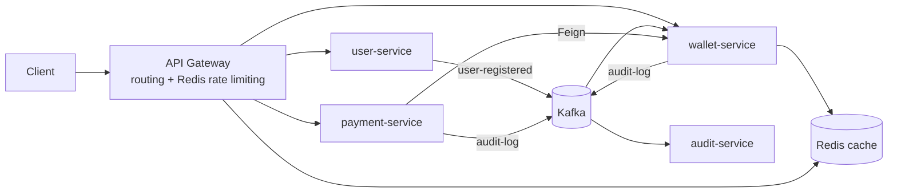

# PayMoney: Digital Wallet Backend

<p align="center">
  
  
  
  
  
  
  
  
  
  
  
  
  
</p>

A microservices-based digital wallet platform in **Java 21 and Spring Boot 4**. Users register, add money through Razorpay, transfer funds to other wallets and withdraw. The project focuses on the problems that make payment backends hard: **concurrent balance updates, duplicate requests, read latency under load, and failure isolation between services.**

**Stack:** Java 21 · Spring Boot 4.1 · Spring Cloud (Gateway, Eureka, Config, OpenFeign) · PostgreSQL 16 · Redis 7 · Kafka 4 · Flyway · Docker Compose · Apache JMeter

---

## Features

- JWT authentication with refresh tokens, Google OAuth2 login, and role-based authorization (`USER` / `ADMIN`)
- User registration, profile management, and account deactivation and reactivation
- Automatic wallet creation through a Kafka `user-registered` event
- Wallet balance lookup with **Redis cache-aside** and graceful fallback to the database
- Wallet-to-wallet transfers and withdrawals with **idempotency keys** and request-hash validation
- **Pessimistic row locking** with ordered lock acquisition to prevent deadlocks
- Razorpay Payment Links with server-side payment verification and duplicate-safe deposits
- **Paginated** transaction history and user listing with bounded page size
- **Composite database indexes** on the transaction history access path
- Ownership checks so users can only access their own wallet and transactions
- Fraud rule limiting successful transfers per wallet per minute
- Redis-backed API rate limiting at the gateway (atomic Lua script)
- Kafka-based audit logging in a dedicated service
- Centralized configuration (Config Server) and service discovery (Eureka)
- OpenAPI / Swagger documentation and Flyway database migrations
- Load-tested with Apache JMeter (latency, P95, throughput)

---

## Performance work

Three read endpoints were optimized with **pagination, Redis caching and database indexing**, then load-tested with Apache JMeter through the API gateway.

| Endpoint | Technique applied | Avg latency | P95 | Throughput | Errors |
|---|---|---:|---:|---:|---:|
| `GET /api/v1/wallet` | Redis cache-aside (2 min TTL) | 137 ms | 214 ms | 30.5 req/s | 0% |
| `GET /api/v1/wallet/transactions` | Pagination + composite indexes | 446 ms | 1,464 ms | 15.2 req/s | 0% |
| `GET /api/v1/all-users` | Pagination | 91 ms | 211 ms | 33.5 req/s | 0% |

> **Test conditions:** `[JMeter threads / ramp-up / loop count or duration]`, `[number of seeded users and transactions]`, `[machine: CPU / RAM]`, all services running locally in Docker Compose. Figures are representative values from repeated runs. The first run was a cold-start outlier, mainly in tail latency, so it was excluded from the representative figures. These are measurements of the optimized build, not a before/after comparison.

**What was done and why**

- **Pagination.** Transaction history and the user list return `Page<T>` with bounded page size (`size` is capped at 100). Responses stay small no matter how large the table grows.
- **Composite indexes** (migration `V7`). Indexes on `transactions (sender_wallet_id, created_at DESC)` and `transactions (receiver_wallet_id, created_at DESC)` match the history query's filter and sort order, so the database can read rows already ordered instead of sorting them.
- **Redis cache-aside on wallet reads.** `getMyWallet()` is cached per user with a 2-minute TTL and a typed JSON serializer restricted to an allow-list of packages. Any transfer, withdrawal or deposit evicts the cache entries.
- **Cache failures never break requests.** A custom `CacheErrorHandler` falls back to the database if Redis is unavailable. This matters most on writes: the money has already moved when the cache is evicted, so an eviction error must not turn into a 500.

---

## Architecture



| Service | Responsibility |
|---|---|
| `api-gateway` | Single entry point, route resolution through Eureka, fixed-window rate limiting |
| `user-service` | Registration, login, JWT access and refresh tokens, Google OAuth2 login, account deactivation and reactivation |
| `wallet-service` | Wallets, transfers, withdrawals, deposits, transaction history |
| `payment-service` | Razorpay payment links and server-side payment verification |
| `audit-service` | Consumes audit events from Kafka and persists them |
| `discovery-server` / `config-server` | Eureka registry and centralized configuration |

Each business service owns its own PostgreSQL database. Services communicate asynchronously through Kafka and synchronously through OpenFeign, with explicit connect and read timeouts so one slow service cannot stall its callers.

---

## Backend concepts demonstrated

### Concurrency-safe money movement
Transfers lock both wallet rows with `SELECT ... FOR UPDATE` (JPA `PESSIMISTIC_WRITE`) inside a single database transaction. **Locks are always acquired in ascending wallet-ID order**, so two opposite transfers (A→B and B→A) cannot deadlock each other.

### Idempotent transfers and withdrawals
Clients send an `Idempotency-Key` header. The server stores the key together with a **SHA-256 hash of the request payload**, scoped per user by a unique constraint (`V11`).

- Same key and same payload: the original result is returned and no money moves twice.
- Same key and different payload: the request is rejected.
- The key is checked before and again after acquiring the row locks, and the unique constraint is the final guard against two simultaneous requests with the same key.

### Idempotent deposits
Razorpay payments are verified server-side. Deposits are keyed on the payment ID, so retrying a verification or receiving a duplicate callback cannot credit a wallet twice.

### Money handling
Balances use `NUMERIC(19,2)` and `BigDecimal` throughout. Amounts are validated for positivity, an upper limit and a maximum of two decimal places.

### Security
- JWT authentication with `USER` and `ADMIN` roles enforced through method-level `@PreAuthorize`.
- Ownership checks: a user can only transfer from their own wallet and only read their own transactions.
- Internal service-to-service endpoints require a separate `X-Internal-Key`.
- Passwords hashed with BCrypt, refresh tokens stored only as hashes.

### Resilience and operations
- Gateway rate limiting implemented as an atomic Redis Lua script (`INCR` plus `EXPIRE`), with per-endpoint-group limits.
- A simple fraud rule blocks more than 5 successful transfers per wallet per minute.
- Flyway versioned migrations, with `ddl-auto=validate` so the schema is only ever changed by migrations.
- Health checks and ordered startup (`depends_on: service_healthy`) across 10 containers in Docker Compose.

---

## API overview

All requests go through the gateway at `http://localhost:8080`. Swagger UI is available per service for the full request schemas.

| Method | Endpoint | Access |
|---|---|---|
| `POST` | `/api/v1/register-user` | Public |
| `POST` | `/api/v1/auth/login` | Public |
| `GET` | `/api/v1/all-users?page=&size=` | Admin |
| `GET` | `/api/v1/wallet` | User (cached) |
| `POST` | `/api/v1/transfers` | User, requires `Idempotency-Key` |
| `POST` | `/api/v1/withdrawals` | User, requires `Idempotency-Key` |
| `GET` | `/api/v1/wallet/transactions?page=&size=` | User |
| `GET` | `/api/v1/transactions/{id}` | User, owner only |
| `POST` | `/api/v1/payment-links` | User |
| `POST` | `/api/v1/payment-link-verifications` | User |

---

## Key flows

### Money transfer
1. Validate the `Idempotency-Key`, amount (positive, capped, two decimals) and that sender and receiver differ.
2. Return the stored result if this user already used the key with the same payload hash; reject if the payload differs.
3. Lock both wallets in ascending ID order (`SELECT ... FOR UPDATE`).
4. Re-check the idempotency key now that the locks are held.
5. Verify the sender wallet belongs to the authenticated user, run the fraud rule, and check the balance.
6. Debit, credit, save the transaction and the idempotency record in one database transaction.
7. Evict the cached wallets and publish an audit event to Kafka.

### Adding money (Razorpay)
1. `payment-service` creates a Razorpay Payment Link and stores a pending payment.
2. After the user pays, the verification endpoint checks the payment with Razorpay on the server side: status, **currency (INR) and exact captured amount**.
3. Only then does `payment-service` call `wallet-service` to credit the wallet. The deposit is idempotent per payment ID, so a retry after a failure never credits twice.

### Registration
`user-service` saves the user and publishes a `user-registered` event. `wallet-service` consumes it and creates the wallet, so user signup does not depend on the wallet service being up.

---

## Key design decisions

| Decision | Reasoning |
|---|---|
| Pessimistic locking over optimistic versioning for balances | Wallet rows are contended hot spots. Locking gives a simple, correct guarantee instead of retry loops on conflicts. |
| Lock wallets in ascending ID order | Removes the lock-order inversion that causes deadlocks between opposite transfers. |
| Idempotency key plus payload hash, unique per user | Protects against client retries and against a key being reused for a different payment. |
| Kafka for wallet creation and auditing | These do not need to block the user's request, and the services stay loosely coupled. |
| Kafka retries with a dead-letter topic | Failed events are retried 5 times (1 s apart), then moved to `<topic>.DLT` instead of being lost. This also covers `user-updated` arriving before the wallet exists. |
| Database per service | Each service owns its schema and migrations. No cross-service joins. |
| Feign for payment-to-wallet calls | A deposit needs an immediate, confirmed result, so it is synchronous, with 2 s connect and 5 s read timeouts. |
| Cache-aside with a 2-minute TTL | Wallet reads are frequent and tolerate brief staleness. Writes evict explicitly, and the TTL bounds any missed eviction. |
| Fail-closed rate limiting | If Redis is unavailable, the gateway returns 503 for rate-limited endpoints rather than letting sensitive routes go unprotected. |
| Flyway with `ddl-auto=validate` | The schema changes only through reviewed, versioned migrations. |

---

## Engineering practices

- Layered structure in every service: controller, service, repository, mapper, DTO.
- Bean validation on request DTOs and a global exception handler in the user, wallet and payment services for consistent error responses.
- Secrets supplied only through environment variables. `environmentFile.env.example` documents them and the real file is git-ignored.
- Multi-stage Docker builds that produce small JRE-only runtime images.
- Internal service ports are bound to `127.0.0.1` in Docker Compose, so client traffic goes through the gateway.
- Unit tests for transfer and idempotency logic, the fraud rule, payment verification, user logic, the rate-limit filter and the audit consumer.

---

## Project structure

```text
PayMoney/
├── api-gateway/        routing, rate limiting
├── user-service/       auth, users, tokens
├── wallet-service/     wallets, transfers, history, cache
├── payment-service/    Razorpay payment links
├── audit-service/      Kafka audit consumer
├── discovery-server/   Eureka
├── config-server/      centralized configuration
├── docker/             database init script
├── load-tests/         JMeter test plans
├── docker-compose.yml
└── pom.xml             Maven multi-module parent
```

---

## Author

**Ayush Sinha**, Backend Developer (Java, Spring Boot)
GitHub: [VASUSINH](https://github.com/VASUSINH)
