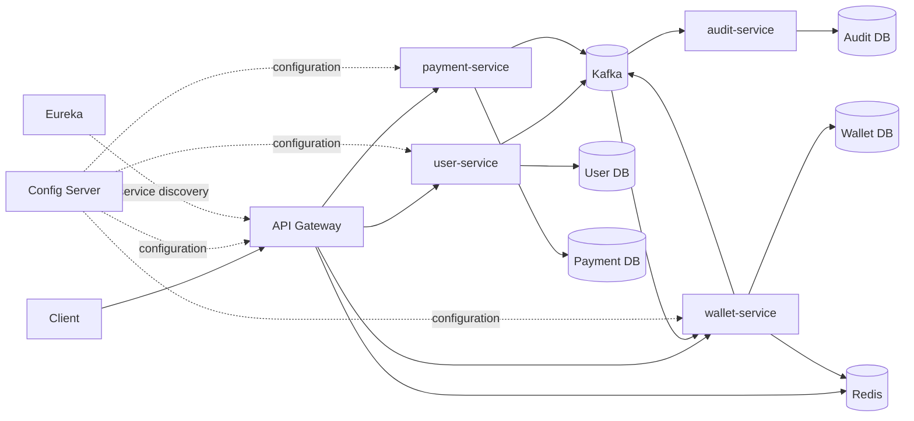
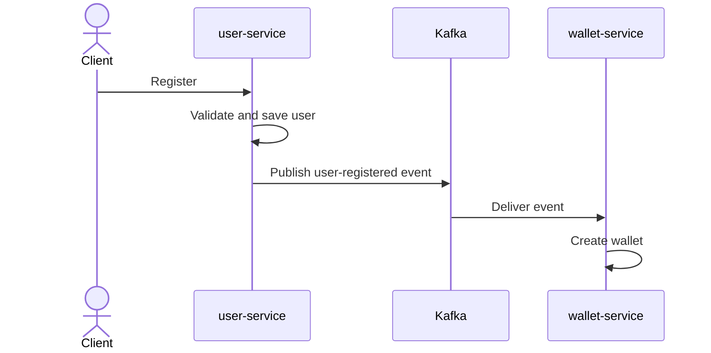
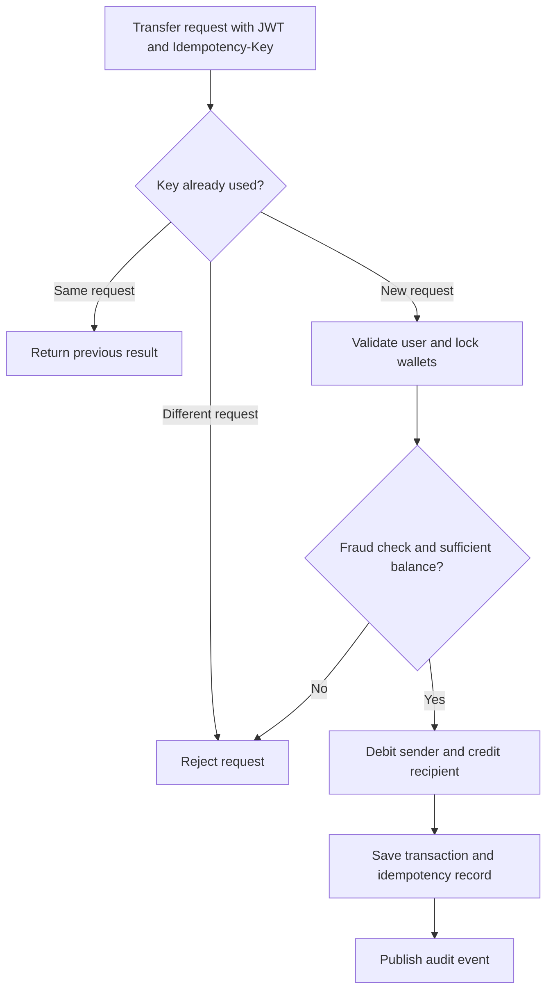

# PayMoney – Digital Wallet & Payments Platform

<p align="center">
  
  
  
  
  
  
  
  
  
  
  
  
</p>

PayMoney is a backend digital-wallet platform built with **Java 21, Spring Boot, PostgreSQL, Redis, Kafka, and Docker**. It uses a microservices architecture to support user accounts, wallet transfers, withdrawals, and Razorpay payment links.

## Features

- JWT authentication and role-based authorization (`USER` / `ADMIN`)
- User registration, profile management, and account deactivation/reactivation
- Wallet creation and balance lookup with Redis caching
- Wallet-to-wallet transfers and withdrawals with idempotency keys
- Razorpay Payment Links with server-side payment verification
- Paginated transaction history and ownership checks
- Fraud checks and database row locking for safer concurrent transfers
- Redis-backed API rate limiting at the gateway
- Kafka-based audit logging
- OpenAPI / Swagger documentation and Flyway database migrations

## Technology Stack

| Area | Technologies |
|---|---|
| Language and framework | Java 21, Spring Boot, Spring MVC, Spring Data JPA |
| Microservices | Spring Cloud Gateway, Eureka, Config Server, OpenFeign |
| Messaging | Apache Kafka |
| Data | PostgreSQL, Redis, Flyway |
| Security | Spring Security, JWT, BCrypt |
| Payments | Razorpay Java SDK |
| Build and deployment | Maven, Docker, Docker Compose |

## Architecture



### Services

| Service | Responsibility |
|---|---|
| `api-gateway` | Entry point, routing, and rate limiting |
| `user-service` | Registration, login, JWT, profiles, and account status |
| `wallet-service` | Wallets, transfers, withdrawals, deposits, and transaction history |
| `payment-service` | Razorpay payment links and payment verification |
| `audit-service` | Consumes audit events from Kafka and stores them |
| `discovery-server` | Eureka service registry |
| `config-server` | Centralized service configuration |

Each business service owns its database. Services use Kafka for event-based communication and OpenFeign for synchronous service calls.

## Key Flows

### User registration



### Wallet transfer



## API Endpoints

Use the API Gateway as the entry point:

`http://localhost:8080`

| Method | Endpoint | Access |
|---|---|---|
| `POST` | `/api/v1/register-user` | Public |
| `POST` | `/api/v1/auth/login` | Public |
| `POST` | `/api/v1/auth/reactivate` | Public |
| `PATCH` | `/api/v1/users/me/deactivate` | User |
| `GET` | `/api/v1/all-users` | Admin |
| `GET`, `PUT` | `/api/v1/users/{userId}` | Admin |
| `GET` | `/api/v1/wallet` | User |
| `POST` | `/api/v1/transfers` | User; requires `Idempotency-Key` |
| `POST` | `/api/v1/withdrawals` | User; requires `Idempotency-Key` |
| `GET` | `/api/v1/wallet/transactions?page=&size=` | User |
| `GET` | `/api/v1/transactions/{transactionId}` | User |
| `POST` | `/api/v1/payment-links` | User |
| `POST` | `/api/v1/payment-link-verifications` | User |
| `GET` | `/api/v1/payment-links/callback` | Razorpay callback |

## Testing the API

### 1. Start the services

Create a local environment file from the example and fill in the required values:

```bash
cp environmentFile.env.example environmentFile.env
```

Start the application:

```bash
docker compose --env-file environmentFile.env up --build
```

Wait for the services to finish starting. The API Gateway is available at `http://localhost:8080`.

### 2. Open Swagger UI

Use Swagger to inspect each endpoint’s request schema, required fields, and responses:

- User service: `http://localhost:8081/swagger-ui.html`
- Wallet service: `http://localhost:8082/swagger-ui.html`
- Payment service: `http://localhost:8083/swagger-ui.html`

For normal API testing, send requests through the gateway at port `8080`.

### 3. Test the main user flow

1. Register a user using `POST /api/v1/register-user`.
2. Log in using `POST /api/v1/auth/login` and copy the JWT from the response.
3. In Swagger, click **Authorize** and enter `Bearer <your-token>`. For a REST client, send the token in the `Authorization` header:

   ```http
   Authorization: Bearer <your-token>
   ```

4. Check the wallet using `GET /api/v1/wallet`.
5. Create a payment link using `POST /api/v1/payment-links`. Complete the payment through Razorpay’s test environment, then verify it using the payment verification endpoint.
6. Transfer money using `POST /api/v1/transfers`. Include a unique `Idempotency-Key` header.
7. Withdraw money using `POST /api/v1/withdrawals`, also with a unique `Idempotency-Key`.
8. Review transactions using the transaction-history endpoint.

Use Swagger’s request examples for the exact JSON fields expected by each endpoint.

### 4. Check important behaviors

- Repeat a transfer request with the same idempotency key and same payload; it should not move money twice.
- Reuse that key with a different payload; the request should be rejected.
- Try a transfer with insufficient balance; it should fail without changing wallet balances.
- Confirm a user cannot view another user’s wallet or transaction.
- Test payment verification with valid and invalid payment details using Razorpay test credentials.

## Run Locally

**Requirement:** Docker Desktop.

```bash
cp environmentFile.env.example environmentFile.env
docker compose --env-file environmentFile.env up --build
```

The database initialization script creates the databases, and Flyway applies migrations during service startup.

- API Gateway: `http://localhost:8080`
- Eureka dashboard: `http://localhost:8761`

Required environment variables include `DB_USERNAME`, `DB_PASSWORD`, `JWT_SECRET`, `PAYMONEY_ADMIN_EMAIL`, `PAYMONEY_ADMIN_PASSWORD`, `RAZORPAY_KEY_ID`, `RAZORPAY_KEY_SECRET`, `APP_PUBLIC_BASE_URL`, and `INTERNAL_API_KEY`.

**Do not commit `environmentFile.env` or real credentials.** Use `environmentFile.env.example` as the template.

## Project Structure

```text
PayMoney/
├── api-gateway/
├── user-service/
├── wallet-service/
├── payment-service/
├── audit-service/
├── discovery-server/
├── config-server/
├── docker/
├── docker-compose.yml
└── pom.xml
```

## What This Project Demonstrates

PayMoney was built to apply backend engineering concepts in a practical fintech-style application, including:

- Designing and organizing services in a microservices architecture.
- Building REST APIs with Java and Spring Boot.
- Implementing authentication and role-based authorization using Spring Security and JWT.
- Managing wallet and transaction workflows with database transactions.
- Using PostgreSQL for persistence, Redis for caching, and Kafka for asynchronous communication.
- Managing database schema changes with Flyway.
- Containerizing services and supporting local development with Docker Compose.
- Documenting and exploring APIs through Swagger UI.

The project reflects my hands-on learning and practical application of backend engineering concepts.


## Authors

**Ayush Sinha**  
Backend Developer | Java & Spring Boot
- GitHub: [VASUSINH](https://github.com/VASUSINH)
- Project: [PayMoney](https://github.com/VASUSINH/PayMoney)

Built as a backend engineering project to explore microservices, secure payment workflows, and event-driven communication.
