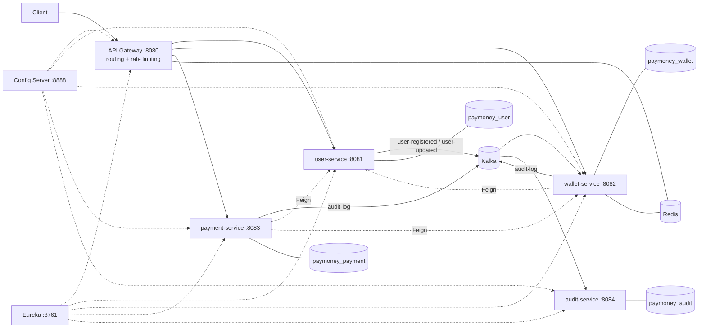
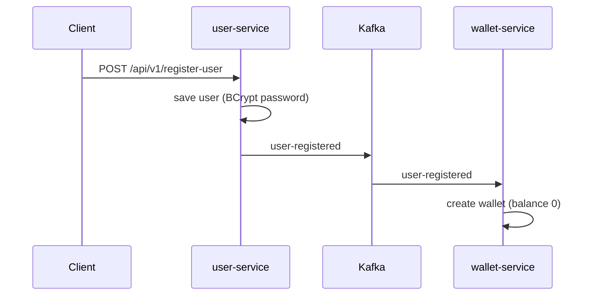
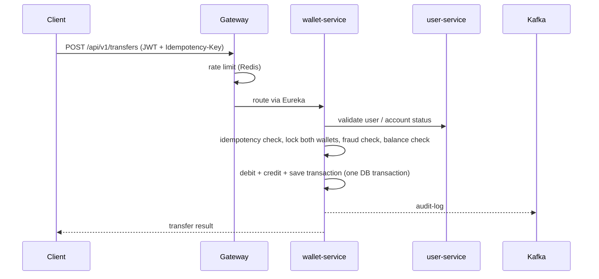
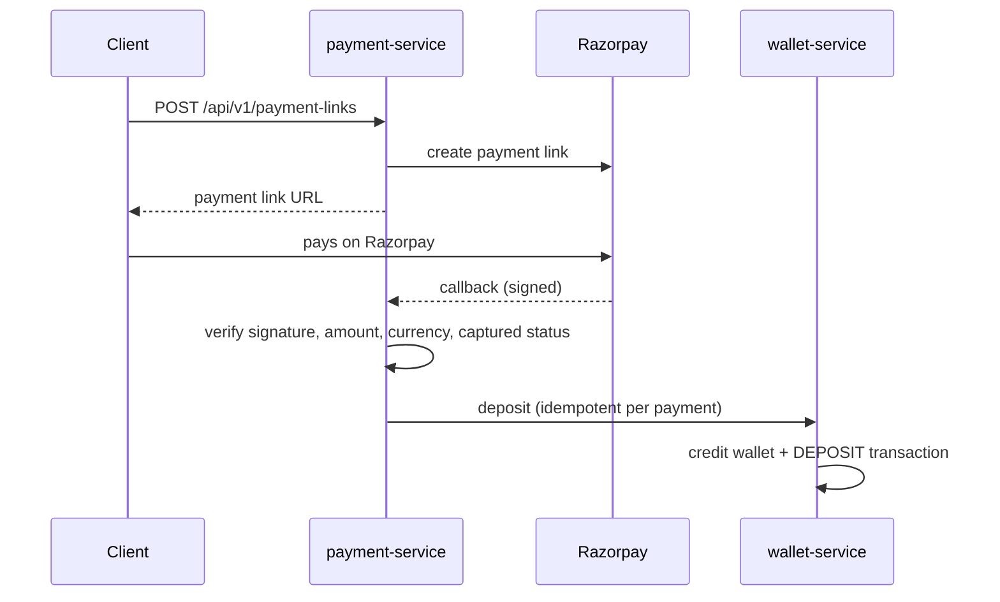
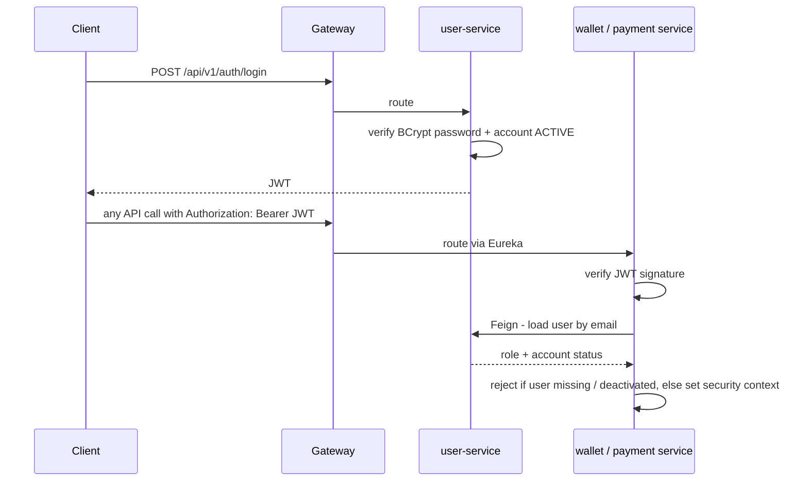
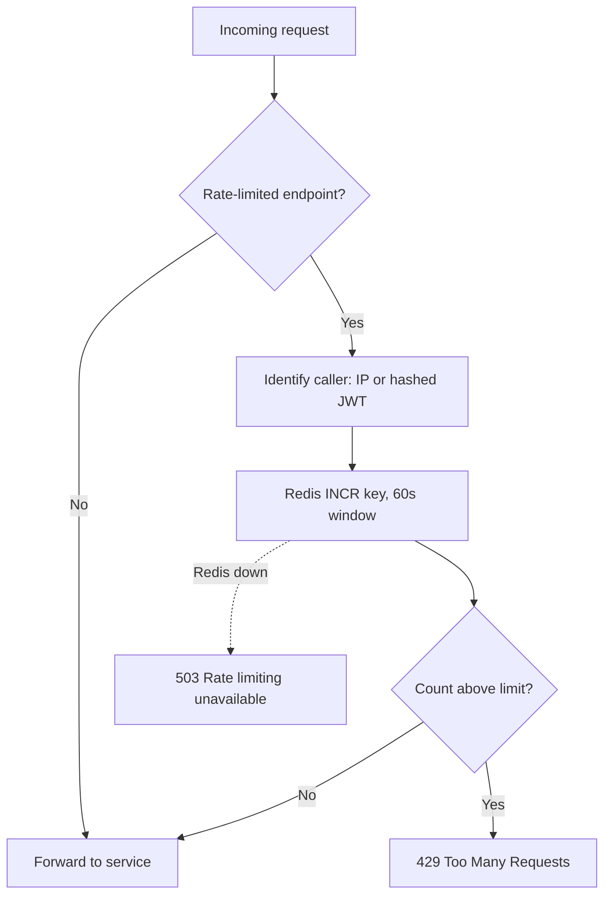
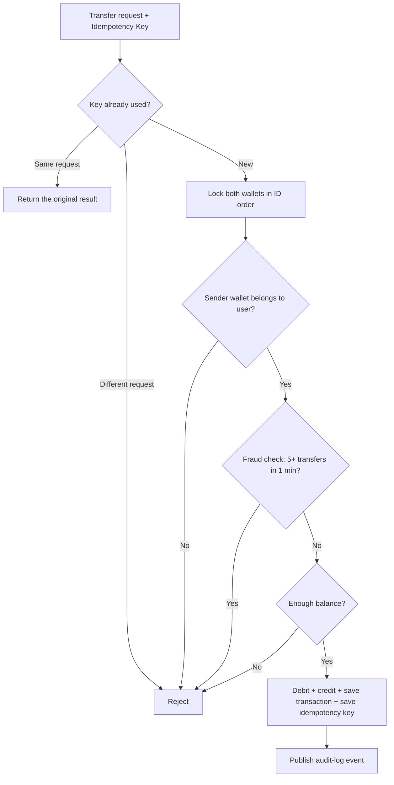
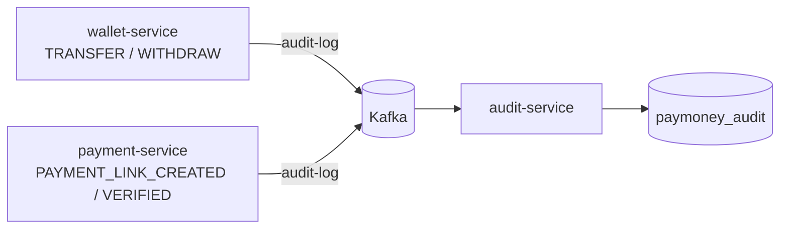
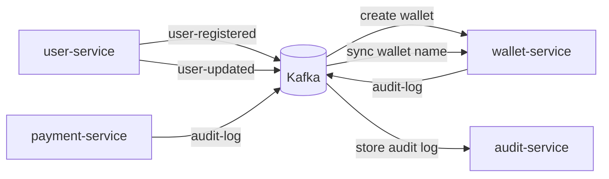
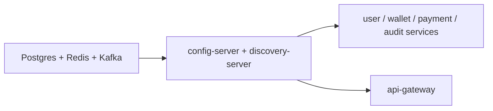

# PayMoney – Digital Wallet & Payments Platform

<p align="center">
  
  
  
  
  
  
  
  
  
  
  
  
  
  
</p>

A backend digital-wallet system built with **Java 21, Spring Boot 4, PostgreSQL, Redis, Kafka and Docker**
using a **microservices architecture**. Users can register, add money through Razorpay, transfer money to
other wallets, withdraw, and view their transaction history – with the safety guarantees a money system needs
(idempotent requests, row-level locking, fraud checks, audit trail, rate limiting).

## Features

* **Authentication & authorization** – JWT login, `USER` / `ADMIN` roles, account deactivation & reactivation, auto-created admin account
* **Wallets** – one wallet per user, balance lookup (cached in Redis)
* **Money transfer** – wallet-to-wallet transfers with an `Idempotency-Key` header, so retries never move money twice
* **Withdrawals** – idempotent withdrawals with balance validation
* **Add money** – Razorpay Payment Links with server-side signature + amount + currency verification before the wallet is credited
* **Transaction history** – paginated, newest first, with ownership checks
* **Fraud check** – blocks a wallet that makes too many transfers within a minute
* **Concurrency safety** – pessimistic row locks, acquired in a fixed order to avoid deadlocks
* **Rate limiting** – Redis-backed limiter at the API Gateway for login, register, transfers, withdrawals and payments
* **Audit logging** – transfers, withdrawals, deposits and payment-link events are published to Kafka (after the DB commit) and stored by a dedicated audit service
* **API docs** – Swagger / OpenAPI with a JWT bearer scheme
* **Database versioning** – Flyway migrations in every service

## Tech stack

| Area | Technology |
|---|---|
| Language / framework | Java 21, Spring Boot 4.1, Spring MVC, Spring Data JPA, Spring Security |
| Microservices | Spring Cloud Gateway, Eureka (service discovery), Config Server, OpenFeign |
| Messaging | Apache Kafka |
| Data | PostgreSQL (database per service), Redis (cache + rate limiting), Flyway |
| Payments | Razorpay Java SDK |
| Auth | JWT (jjwt), BCrypt |
| DevOps | Docker, Docker Compose, Maven multi-module |

## Architecture



| Service | Responsibility | Database |
|---|---|---|
| `api-gateway` | Single entry point, routing via Eureka, Redis rate limiting | – |
| `user-service` | Registration, login/JWT, profile & admin APIs, account status | `paymoney_user` |
| `wallet-service` | Wallets, transfers, withdrawals, deposits, transaction history, idempotency, fraud check, Redis cache | `paymoney_wallet` |
| `payment-service` | Razorpay payment links and verification | `paymoney_payment` |
| `audit-service` | Consumes audit events from Kafka and stores them | `paymoney_audit` |
| `discovery-server` | Eureka service registry | – |
| `config-server` | Centralised configuration for all services | – |

Each service is an independent Spring Boot app (embedded Tomcat), has its own Dockerfile and owns its own database.
Services talk **asynchronously through Kafka** (events) and **synchronously through OpenFeign** (lookups, wallet credit).

## Key flows

**Registration**


**Transfer**


**Add money (Razorpay)**


**Login & request authentication (JWT)**


**Rate limiting at the gateway**


**Transfer safety checks inside wallet-service**


**Audit logging (event-driven)**


**Kafka event map**


**Startup order (Docker Compose)**


## API overview (via the gateway, `http://localhost:8080`)

| Method | Endpoint | Access |
|---|---|---|
| POST | `/api/v1/register-user` | Public |
| POST | `/api/v1/auth/login` | Public |
| POST | `/api/v1/auth/reactivate` | Public |
| PATCH | `/api/v1/users/me/deactivate` | User |
| GET | `/api/v1/all-users` | Admin |
| GET / PUT | `/api/v1/users/{userId}` | Admin |
| GET | `/api/v1/wallet` | User |
| POST | `/api/v1/transfers` (`Idempotency-Key` header) | User |
| POST | `/api/v1/withdrawals` (`Idempotency-Key` header) | User |
| GET | `/api/v1/wallet/transactions?page=&size=` | User |
| GET | `/api/v1/transactions/{transactionId}` | User |
| POST | `/api/v1/payment-links` | User |
| POST | `/api/v1/payment-link-verifications` | User |
| GET | `/api/v1/payment-links/callback` | Razorpay callback |

Swagger UI per service (only reachable from your own machine): `http://localhost:8081/swagger-ui.html` (user), `:8082` (wallet), `:8083` (payment).

See `TESTING.md` for step-by-step endpoint testing.

## Reliability & security notes

* **Internal endpoints** (`/api/v1/internal/**`) need the `X-Internal-Key` header (value from `INTERNAL_API_KEY`). Feign adds it automatically; the gateway never routes these paths.
* **Service ports** 8081-8084 are bound to `127.0.0.1` only, so the outside world can only reach the gateway (8080).
* **Kafka after commit** – audit events are sent only after the DB transaction commits, with `max.block.ms=2000` so a Kafka outage cannot hang a transfer.
* **Retry + dead letter topic** – a failing Kafka listener retries 5 times, then the message goes to `<topic>.DLT`.
* **Redis down** – the wallet cache is skipped (database is used) instead of failing the request.
* **Feign timeouts** – 2s connect / 5s read.
* **Idempotency keys** are unique per user, not globally.

Known limitations (good discussion points): no outbox pattern for the user-registered event, no circuit breaker (Resilience4j), no Razorpay webhook, JWTs have no expiry.

## Run locally

Requirements: Docker Desktop.

```bash
cp environmentFile.env.example environmentFile.env      # fill in your values
docker compose --env-file environmentFile.env up --build
```

Databases are created automatically (init script) and tables are created by Flyway on startup.
Eureka dashboard: `http://localhost:8761`.

Environment variables (`environmentFile.env`): `DB_USERNAME`, `DB_PASSWORD`, `JWT_SECRET`, `PAYMONEY_ADMIN_EMAIL`,
`PAYMONEY_ADMIN_PASSWORD`, `RAZORPAY_KEY_ID`, `RAZORPAY_KEY_SECRET`, `APP_PUBLIC_BASE_URL`, `INTERNAL_API_KEY`.

## Project structure

```
PayMoney/
├── api-gateway/        ├── user-service/      ├── wallet-service/
├── payment-service/    ├── audit-service/     ├── discovery-server/
├── config-server/      ├── docker/            ├── docker-compose.yml
└── pom.xml             (each service: Config, Controller, DTO, Entity, Exception,
                         Mapper, Repository, Service, db/migration)
```